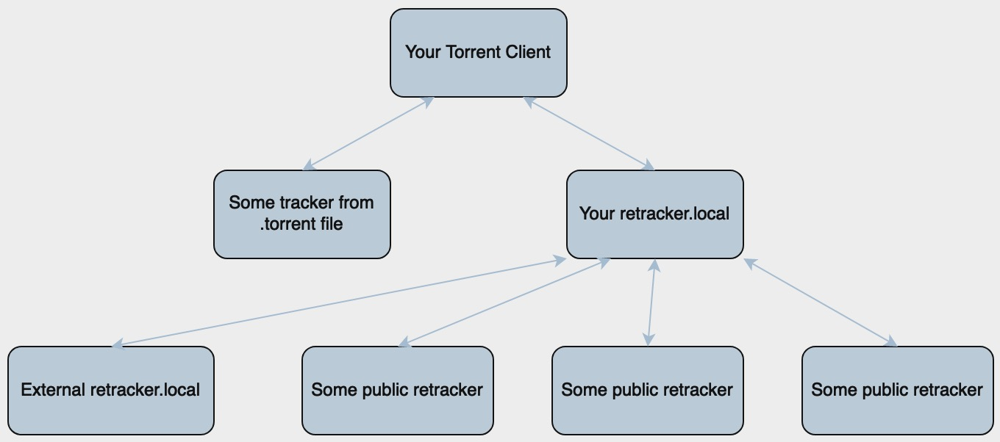

# retracker



Lightweight BitTorrent tracker (HTTP + UDP, BEP 15) in a single Go binary. Everything is in-memory; no database or external web stack required.

This is built with extensive help from different AI agents, as an experiment.

## Features (concise)
- HTTP and UDP announce/scrape with shared core logic (BEP 15 compliant)
- Forwarding to external trackers (HTTP/HTTPS/UDP) with peer aggregation
- Adaptive worker pool with rate limiting and throttling for forwarders
- Prometheus metrics endpoint
- IPv4/IPv6 support and secure connection ID handling for UDP

## Quick start
```bash
go install github.com/fl0v/retracker/cmd/retracker@latest
retracker -l :6969 -u :6969 -d
```
Add `udp://<your ip>:6969/announce` to your torrent (preferred). Use
`http://<your ip>:6969/announce` if UDP is unavailable. Choose one URL per
torrent; both protocols share the same peer storage.

Full installation and deployment options are in [INSTALL.md](INSTALL.md).

## Usage highlights
- Enable UDP alongside HTTP:
  ```bash
  retracker -l :6969 -u :6969 -d
  ```
- Load forwarders and aggregate peers:
  ```bash
  retracker -l :6969 -d -f forwarders.yml
  ```
- Prometheus metrics: `GET /metrics` (when enabled in config)

## HTTP API
- `GET /announce` - BitTorrent announce endpoint on any configured HTTP port.
- `GET /` - alias for `/announce` only when the request's Host header specifies port `6969`.
- `GET /` on port 80 (including a Host header without a port) - HTTP 200 with `retracker is live`.
- `GET /scrape` - BitTorrent scrape endpoint.
- `GET /stats` - text stats (`GET /stats?format=json` for JSON).
- `POST /add-forwarder` - add forwarder URLs at runtime (in-memory only, lost on restart).
  - Request body JSON (multiple only): `{"urls":["https://t1.example.com/announce","udp://t2.example.com:6969/announce"]}`
- `GET /add-forwarder` - add forwarder URLs from query string.
  - Query format: `?urls=url1,url2,` (comma-separated, trailing comma allowed)
  - Responses:
    - `200` when all are added, or when partially added (`status: "partial"`)
    - `400` when all requested URLs fail validation
    - `409` when all requested URLs already exist
  - Response body includes per-URL result list and counters: `added`, `failed`, `results[]`

Example:
```bash
curl -X POST http://127.0.0.1:6969/add-forwarder \
  -H 'Content-Type: application/json' \
  -d '{"urls":["udp://tracker.example.com:6969/announce","https://tracker2.example.com/announce"]}'
```

```bash
curl "http://127.0.0.1:6969/add-forwarder?urls=udp://tracker.example.com:6969/announce,https://tracker2.example.com/announce,"
```

## Docker
- Build: `docker build -f docker/Dockerfile -t retracker .` (from the repository root)
- Run: `docker run -d -p 6969:6969/tcp -p 6969:6969/udp -e RETRACKER_UDP_LISTEN=:6969 retracker`
- Compose: `docker compose -f docker/docker-compose.yml up -d --build`

See [INSTALL.md](INSTALL.md) for configuration env vars and examples.

## Documentation

- [INSTALL.md](INSTALL.md) - Installation and deployment options
- [docs/ANNOUNCE_LOGIC.md](docs/ANNOUNCE_LOGIC.md) - Announce handling logic and diagram
- [docs/QUEUE_AND_SCHEDULER.md](docs/QUEUE_AND_SCHEDULER.md) - Queue and scheduler implementation
- [docs/BITTORRENT.md](docs/BITTORRENT.md) - BitTorrent protocol reference

## Development

The project uses one root Go module. The `common/` and `bittorrent/` directories are ordinary packages; `go test ./...` discovers all of them.

Other projects importing these packages should depend on the root module, `github.com/fl0v/retracker`. Package import paths stay the same; all packages share the root module's release version and Go requirement.

- Format: `make fmt` (gofumpt)
- Lint: `make lint` (golangci-lint)
- All checks: `make check`
- Tests across all packages: `make test`
- Race detection and combined coverage: `make test-race` (writes `coverage.out`)
- View coverage: `go tool cover -html=coverage.out`

GitHub Actions runs formatting, lint, race tests with coverage, and a Linux build for pull requests, pushes to `master`, and published releases. Image publishing waits for this QA job and runs only for master pushes and releases. Each successful run saves a coverage artifact for 14 days.

Runtime service logs use Go `slog` text records on stdout in the CLI; debug
records are enabled with `-d`. Announce failures and forwarder outcomes include
structured context such as hash, protocol, timing, and errors. Each running
tracker serves its own Prometheus registry, including Go and process metrics.

## License

MIT License - see [LICENSE](LICENSE).
