# Announcement Logic

This document describes how retracker handles BitTorrent announcements, including event handling, forwarder queuing, rate limiting, and response generation.

HTTP announces use `/announce`. The exact root path `/` is an alias only when
the request Host includes port `6969`; both endpoints run the same announce logic.
Root on port `80` (or with no port in Host) returns HTTP 200 with
`retracker is live`, without processing an announce. Root on other ports and
unrecognized paths return HTTP 404.

## Current Implementation Note (v0.10.0)

- `ForwardStoppedEvent()` and `ForwardCompletedEvent()` exist in `forwarderAnnounce.go`, but are not currently invoked from `receiverAnnounce.ProcessAnnounce()`.
- Current stopped/completed behavior in the announce path is local-state handling:
  - `stopped`: delete peer, cancel its session and forwarding jobs, and clean `ForwarderStorage` for the hash if no local peers remain. Upstream stopped events are not sent.
  - `completed`: update local storage and continue normal response flow.

## Flow Diagram

```mermaid
flowchart TD
    Start([BitTorrent Client HTTP Announce Request]) --> Parse[Parse Request: info_hash, peer_id, event, etc.]
    Parse --> EventCheck{Event Type?}
    
    %% Stopped Event Path
    EventCheck -->|stopped| StoppedPath[handleStoppedEvent]
    StoppedPath --> DeletePeer[Delete Peer from Local Storage]
    DeletePeer --> CancelJobs[Cancel Peer Session and Pending Jobs]
    CancelJobs --> CheckLocal{Local Peers Remaining?}
    CheckLocal -->|No| CleanupForwarder[Cleanup ForwarderStorage for info_hash]
    CheckLocal -->|Yes| StoppedResponse[Return Response with interval]
    CleanupForwarder --> StoppedResponse
    StoppedResponse --> End1([Response to Client])
    
    %% Completed Event Path
    EventCheck -->|completed| CompletedPath[handleCompletedEvent]
    CompletedPath --> UpdateStorage1[Update Local Storage]
    UpdateStorage1 --> GetPeers1[Get Peers from Local + Forwarder Storage]
    GetPeers1 --> CompletedResponse[Return Response with peers + interval]
    CompletedResponse --> End2([Response to Client])
    
    %% Regular/Started Event Path
    EventCheck -->|started/empty| RegularPath[handleRegularAnnounce]
    RegularPath --> UpdateStorage2[Update Local Storage]
    UpdateStorage2 --> GetLocalPeers[Get Local Peers]
    GetLocalPeers --> FirstCheck{First Announce for info_hash?}
    
    %% First Announce Path
    FirstCheck -->|Yes| FirstAnnounce[handleFirstAnnounce]
    FirstAnnounce --> RateLimitCheck{Rate Limit Active?}
    RateLimitCheck -->|Yes & Exceeded| RateLimitReject[Reject: Return retry interval]
    RateLimitReject --> End3([Response to Client])
    RateLimitCheck -->|No| QueueFullCheck{Queue Full?}
    QueueFullCheck -->|Yes| QueueFullReject[Reject: Return retry interval]
    QueueFullReject --> End3
    QueueFullCheck -->|No| GetCachedPeers1[Get Cached Forwarder Peers - usually empty]
    GetCachedPeers1 --> QueueEligible[QueueEligibleAnnounces]
    QueueEligible --> ShouldAnnounce{ShouldAnnounceNow?}
    ShouldAnnounce -->|Yes| QueueJobs1[Queue Jobs Immediately to Worker Pool]
    ShouldAnnounce -->|No| SkipForwarder[Skip Forwarder - NextAnnounce not due]
    SkipForwarder --> QueueJobs1
    QueueJobs1 --> FirstResponse[Return Response - AnnounceInterval]
    FirstResponse --> End3([Response to Client])
    
    %% Subsequent Announce Path
    FirstCheck -->|No| SubsequentAnnounce[handleSubsequentAnnounce]
    SubsequentAnnounce --> GetCachedPeers2[Get Cached Forwarder Peers]
    GetCachedPeers2 --> ReannounceCheck{ShouldAnnounceNow?}
    
    ReannounceCheck -->|Yes| QueueJobs2[Queue Jobs to Worker Pool]
    ReannounceCheck -->|No| SkipReannounce[Skip - NextAnnounce not due]
    SkipReannounce --> SubsequentResponse[Return Response with peers + interval]
    QueueJobs2 --> SubsequentResponse
    SubsequentResponse --> End4([Response to Client])
    
    %% Forwarder Worker Pool Processing
    QueueJobs1 -.->|Job Queue| WorkerPool[Worker Pool - N workers]
    QueueJobs2 -.->|Job Queue| WorkerPool
    
    WorkerPool --> Worker[Worker Picks Job]
    Worker --> ExecuteAnnounce[executeAnnounce]
    ExecuteAnnounce --> ProtocolCheck{Forwarder Protocol?}
    
    ProtocolCheck -->|HTTP/HTTPS| BuildURI[Build HTTP URI with request params]
    ProtocolCheck -->|UDP| UDPConnect[Get or Refresh Connection ID]
    
    BuildURI --> HTTPRequest[HTTP GET Request to Forwarder with Timeout]
    UDPConnect --> UDPAnnounce[Send UDP Announce Packet - BEP 15 - with Retry]
    
    HTTPRequest --> HTTPResponseCheck{Response Status?}
    UDPAnnounce --> UDPResponseCheck{Response Valid?}
    
    HTTPResponseCheck -->|200 OK| ParseHTTPResponse[Parse Bencoded Response]
    HTTPResponseCheck -->|BEP 31 Retry| HandleRetry[handleRetryError: Schedule Retry]
    HTTPResponseCheck -->|Other Error| ErrorHandling[Log Error, Use Empty Peers, Interval 60s]
    
    UDPResponseCheck -->|Success| ParseUDPResponse[Parse Binary UDP Response, Extract Peers]
    UDPResponseCheck -->|Error| ErrorHandling
    
    HandleRetry --> RetryCheck{Permanent failure?}
    RetryCheck -->|No| ScheduleRetry[Schedule Job for Retry Time]
    RetryCheck -->|Yes| DisableForwarder[Disable Forwarder - Retry never]
    ScheduleRetry --> ScheduleMap2[Add to scheduledJobs Map]
    ScheduleMap2 --> SchedulerRoutine2[Scheduler Routine will move to queue when ready]
    SchedulerRoutine2 --> WorkerDone
    
    ParseHTTPResponse --> UpdateForwarderStorage[Update ForwarderStorage: Set NextAnnounce = now + interval]
    ParseUDPResponse --> UpdateForwarderStorage
    UpdateForwarderStorage --> RecordStats[Record Statistics: Response Time, Interval]
    RecordStats --> UnmarkJob[Unmark Job as Pending]
    DisableForwarder --> UnmarkJob
    ErrorHandling --> UnmarkJob
    UnmarkJob --> WorkerDone([Worker Ready for Next Job])
    
    %% Background Processes
    StoragePurge[Background Purge Routine - Every 1 Minute] --> CheckAge{Peer Age > Config.Age?}
    CheckAge -->|Yes| RemovePeer[Remove Stale Peer]
    CheckAge -->|No| KeepPeer[Keep Peer]
    RemovePeer --> CheckEmpty{Hash Empty?}
    CheckEmpty -->|Yes| RemoveHash[Remove Hash Entry]
    CheckEmpty -->|No| StoragePurge
    RemoveHash --> StoragePurge
    KeepPeer --> StoragePurge
    
    %% Styling
    classDef eventPath fill:#ffcccc,stroke:#ff0000,stroke-width:2px
    classDef storagePath fill:#ccffcc,stroke:#00ff00,stroke-width:2px
    classDef forwarderPath fill:#ccccff,stroke:#0000ff,stroke-width:2px
    classDef decision fill:#ffffcc,stroke:#ffaa00,stroke-width:2px
    
    class StoppedPath,CompletedPath,RegularPath eventPath
    class UpdateStorage1,UpdateStorage2,DeletePeer,StoragePurge storagePath
    class ExecuteAnnounce,WorkerPool forwarderPath
    class EventCheck,FirstCheck,ReannounceCheck,CheckAge decision
```

## Configuration

| Setting | YAML key | Default |
|---------|----------|---------|
| Queue size | `forwarder_queue_size` | 10000 |
| Base workers | `forwarder_workers` | 10 |
| Max workers | `max_forwarder_workers` | 20 |
| Scale threshold (% full) | `queue_scale_threshold_pct` | 60 |
| Throttle threshold (% full) | `queue_throttle_threshold` | 60 |
| Throttle top-N forwarders | `queue_throttle_top_n` | 20 |
| Rate-limit threshold (% full) | `queue_rate_limit_threshold` | 80 (0 to disable) |
| Rate-limit tokens/sec | `rate_limit_initial_per_sec` | 10 |
| Rate-limit burst | `rate_limit_initial_burst` | 200 |
| Forwarder suspend seconds | `forwarder_suspend_seconds` | 300 |
| Max forwarders per announce | `max_forwarders_per_announce` | 100 |
| Retry period (rate-limit response) | `retry_period` | 300 |

## Event Handling

- **stopped**: Deletes the peer and ends its session, cancels active HTTP requests, removes scheduled retries and pending markers, and cleans the hash cache if no local peers remain. Workers and result handlers discard stale session jobs, including after a peer restarts. Cache publication and stopped cleanup share the storage lock. Only the active-session check and cache mutation hold that lock; filtering, logging, metrics, and failure bookkeeping run outside it. Stopped cleanup removes only the canceled session's jobs, preserving a concurrent restart.
- **completed**: Updates local storage, continues normal flow
- **started/empty**: Normal announce flow with first/subsequent distinction

## Announce Flow

### Job Types

**Initial Announcements** (`QueueEligibleAnnounces`):
- First time a forwarder sees a hash
- Queued immediately (not scheduled)
- `ShouldAnnounceNow()` checks if forwarder has never seen hash or NextAnnounce is due

**Re-announcements** (`QueueEligibleAnnounces`):
- Same code path as initial announces
- `ShouldAnnounceNow()` must return true (NextAnnounce due)
- If not due → forwarder is skipped (no job created)
  - When more than `max_forwarders_per_announce`, prioritize forwarders that have never announced for the hash, then those most overdue

**Retry Jobs** (BEP 31):
- Created by `handleRetryError()` when forwarder requests retry
- Always scheduled at tracker-specified time
- Every positive, representable retry period schedules a retry and preserves the shared hash/forwarder cooldown; deferred failures never publish a successful zero-interval result
- If `retry_in == "never"` → disable forwarder

### Eligibility Check (`ShouldAnnounceNow`)

Returns `true` if:
- Forwarder has never seen this hash, OR
- `NextAnnounce` is zero or in the past

Returns `false` if:
- `NextAnnounce` is in the future → skip forwarder

### Queue Flow

1. Incoming announces call `QueueEligibleAnnounces()`
2. Forwarders are shuffled for load distribution
3. Each forwarder checked: disabled? suspended? `ShouldAnnounceNow()`?
4. Eligible forwarders are ordered: never-announced first, then most overdue
5. Eligible jobs queued in that order (up to limits)
6. Workers execute jobs and update `NextAnnounce` per forwarder

## Rate Limiting (Initial Announces Only)

Protects the system during high load by rejecting initial announces early.

**When triggered** (both conditions):
1. Queue fill >= `queue_rate_limit_threshold` (default 80%)
2. Token bucket has no tokens

**Token bucket algorithm**:
- Starts with `rate_limit_initial_burst` tokens (default 200)
- Refills at `rate_limit_initial_per_sec` tokens/second (default 10)
- Each allowed announce consumes 1 token

**What happens**:
- Client receives: "tracker busy, retry in X seconds"
- Both `interval` and `min interval` use `retry_period` (default 300 seconds), bypassing the normal announce minimum
- UDP returns the failure as an error packet
- Announce NOT queued to any forwarder
- `rate_limited` counter increments

**Disabling**: Set `queue_rate_limit_threshold: 0`

## Throttling

Limits forwarders per announce when queue is filling up.

**When triggered**:
- Queue fill >= `queue_throttle_threshold` (default 60%)
- `queue_throttle_top_n` > 0 (default 20)

**Behavior**:
- Limits to `queue_throttle_top_n` forwarders
- Forwarders shuffled for load distribution, then prioritized by announce state
- Prioritizes never-announced, then most overdue; shuffle breaks ties

## Max Forwarders Per Announce

**Config**: `max_forwarders_per_announce` (default: 100)

- Limits forwarders even when not throttling
- When throttling: uses `min(max_forwarders_per_announce, queue_throttle_top_n)`
- Prioritization selects never-announced first, then most overdue; shuffle breaks ties

## Queue Full Handling

| Situation | Behavior |
|-----------|----------|
| Initial announce | Client receives: "tracker queue full, retry in 30 minutes" |
| Re-announcement | Job dropped silently, `dropped_full` counter increments |
| Scheduled job | Rescheduled for +10 seconds, no job loss |

## Forwarder Execution

### Protocol Support

- **HTTP/HTTPS**: Standard HTTP GET requests, preserving existing URL query parameters such as passkeys
- **UDP**: BEP 15 protocol with connection ID management
  - Match transaction IDs before interpreting success or error packets; ignore stale packets within the attempt deadline
  - Select peers of the client transport family before applying `numwant` (shared maximum 200)
  - Connection IDs cached with 2-minute lifetime
  - Automatic refresh on expiration
  - Binary packet encoding/decoding

### Retries

**HTTP**:
- Uses `ForwarderRetryAttempts` with exponential backoff
- Base delay: `ForwarderRetryBaseMs`, Timeout: `ForwardTimeout`
- Non-retryable errors disable forwarder
- HTTP 429 triggers suspension instead
- One HTTP client is shared per manager across ordinary and event announces. A client can be supplied at construction through `WithHTTPClient`; its caller owns its configuration and idle-connection cleanup
- The default client owns a clone of the standard default transport. Manager shutdown closes its idle connections after forwarding goroutines finish
- Successful announce bodies are limited to 1 MiB, including automatically decompressed gzip content. Declared or streamed oversized payloads return a retryable failure before decoding or diagnostic-file writes
- Ignored HTTP error and event-response bodies are drained up to 32 KiB without buffering, then closed. Large error bodies still use the HTTP status for retry, suspension, or rejection classification

**UDP**:
- Same retry config as HTTP
- BEP 15 error packets (`action=3`) carry free-form text only (no standard numeric rate-limit code)
- Suspension is triggered when UDP error text matches rate-limit patterns (e.g. "too many requests", "rate limit", "slow down", "throttl", "retry later")

**Retryable errors** (will retry up to configured attempts):
- Request timeout
- HTTP 5xx (server errors)
- Temporary network issues

**Non-retryable errors** (disables forwarder immediately):
- DNS errors: `no such host`, `unknown host`
- Connection refused (port not open)
- `no route to host`, `network is unreachable`
- HTTP 400/403/404 (tracker rejection)

### Forwarder Suspension

**Trigger**:
- HTTP 429 responses
- UDP tracker error text matching rate-limit patterns via `shouldSuspendForwarder()`

**Behavior**:
- Suspended for `forwarder_suspend_seconds` (default 300)
- Skipped for new announces until expiration

## Storage Systems

- **Local Storage**: Thread-safe in-memory peers (`map[InfoHash]map[PeerID]Request`)
- **ForwarderStorage**: Caches peers and intervals from forwarder responses
- **Background Purge**: Removes peers older than `Config.Age` (default 180 minutes) and cancels their sessions
- **Runtime initialization**: Core and receivers share a read/write lock while publishing the first forwarder manager; announce, scrape, and stats readers observe a consistent initialized state
- **HTTP addresses**: Remote endpoints are parsed with `net.SplitHostPort`, preserving IPv6 addresses without brackets
- **UDP lifecycle**: Each packet handler owns its bytes. Closing the receiver stops packet reads and connection cleanup, waits for handlers, and can be repeated safely
- **Application shutdown**: SIGINT/SIGTERM stops HTTP admission and allows five seconds for active requests to finish. The application then closes UDP intake, cancels forwarding requests and retries, joins workers and storage routines, and closes diagnostic-file cleanup. HTTP header, total read, write, and idle timeouts are five, fifteen, thirty, and sixty seconds respectively

## Response Generation

- **First Announce**: Returns `Config.AnnounceInterval` (default 30 min)
- **Subsequent Announces**: Returns `Config.AnnounceInterval`, includes cached forwarder peers
- **Peer Aggregation** (`getPeersForResponse`):
  - Seeders: Local peers with `left=0` or `event=completed`, plus forwarder peers
  - Leechers: Local peers with `left>0` and not completed
  - IP deduplication: Same IP counted only once

## Flow Characteristics

1. **Non-blocking**: Forwarder operations don't block client responses
2. **Parallel Execution**: Forwarder announce jobs execute concurrently via the worker pool
3. **Deduplication**: Prevents duplicate jobs via `pendingJobs` map
4. **Interval Management**: Each forwarder maintains its own `NextAnnounce` per info_hash
5. **Error Handling**: Failed forwarder requests don't affect client response

## Metrics & Stats

**Endpoints**: `/stats` (text & JSON), `/metrics` (Prometheus)

**Queue metrics**: `queue_depth`, `queue_capacity`, `queue_fill_pct`, `queue_dropped_full`, `queue_rate_limited`, `queue_throttled_forwarders`

**Worker metrics**: `forwarder_workers` (current count)

**Forwarder state metrics**:
- `forwarders_disabled`, `forwarders_suspended`
- `forwarder_disabled{name,reason}`
- `forwarder_disabled_failure_count{name}`
- `forwarder_disabled_seconds_since{name}`
- `forwarder_suspended{name,reason}`
- `forwarder_suspended_seconds_remaining{name}`

## Tests

`internal/server/forwarderManager_test.go`:
- Rate-limit threshold disabled/active
- Throttle limits forwarder count
- Max forwarders per announce limit
- Skip recently announced forwarders
- Suspension expiration

`internal/server/forwarderAnnounce_test.go`:
- Announce result handling
- Job pending/cancellation logic
- Suspension trigger conditions
